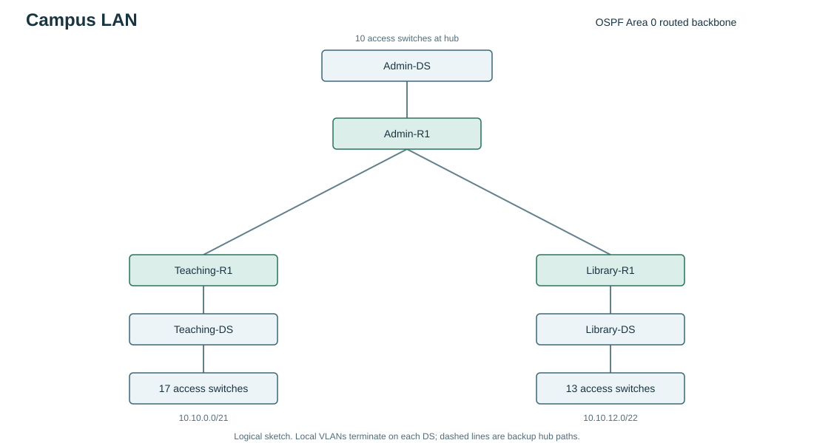

# Campus LAN

CIC-307 - NetArchitect generated plan

## Overview

1600 requested endpoints across 3 sites; 10% endpoint growth reserved. Root: 10.10.0.0/16. All planned links use the assignment's 10 Gb/s media rules.

One HQ edge router connects 2 remote sites. Routed links keep broadcasts local; 802.1Q trunks are limited to each access switch's VLAN and unused native VLAN 999. Rapid-PVST (RSTP per VLAN) protects local L2 wiring. 48-port access switches are counted from planned endpoints, with one VLAN per switch.

One administrative domain and 11 active subnets (<50) fit the assignment's single-area rule. OSPF (RFC 2328) computes shortest paths and recalculates after failure. The 50-subnet cutoff is an assignment policy, not an RFC protocol limit.

Each site's VLAN blocks are placed largest-first inside an aligned site aggregate. Site aggregates and /30 transit blocks are then placed largest-first in the root. Aggregates are reservations, not extra active subnets.

4116 of 65536 root addresses reserved (6.28%). Per-subnet utilization includes endpoint growth and the SVI gateway; root reservation also includes alignment space inside site aggregates.

## Physical media decisions

Endpoint access: Cat6a / 10GBASE-T. 70 m <= 100 m: Cat6a supports the assignment's 10GBASE-T access channel (IEEE 802.3an). The channel includes patch leads. 

In-rack links: Cat6a / 10GBASE-T. 5 m <= 100 m: Cat6a supports the assignment's 10GBASE-T access channel (IEEE 802.3an). The channel includes patch leads. 

HQ local routed uplink: Cat6a / 10GBASE-T. 50 m <= 100 m: Cat6a supports the assignment's 10GBASE-T access channel (IEEE 802.3an). The channel includes patch leads. 

HQ to Teaching: OM4 MMF / 10GBASE-SR. 220 m <= 400 m: OM4 with 850 nm SR optics fits the modal-bandwidth reach limit. Modal dispersion, not just attenuation, limits multimode reach. Verify the installed channel loss. 

HQ to Library: OM4 MMF / 10GBASE-SR. 380 m <= 400 m: OM4 with 850 nm SR optics fits the modal-bandwidth reach limit. Modal dispersion, not just attenuation, limits multimode reach. Verify the installed channel loss. 

## Site capacity and summaries

Admin: 10.10.8.0/22, 10 access switches, 400 current endpoints, 440 planned endpoints. PoE groups: WiFi.

Teaching: 10.10.0.0/21, 17 access switches, 700 current endpoints, 770 planned endpoints. PoE groups: WiFi.

Library: 10.10.12.0/22, 13 access switches, 500 current endpoints, 550 planned endpoints. PoE groups: WiFi.

## VLAN and access policy

Each VLAN's SVI is its default gateway. The first usable IP is reserved for the gateway; endpoints start at network + 2. An inbound ACL rejects sources outside the VLAN subnet.

Isolated VLANs may ping their gateway and reach CloudVPC service subnets when present; they cannot reach other RFC 1918 destinations. Other destinations are permitted but this lab has no Internet route/NAT. ACLs are stateless, so return traffic from isolated VLANs to internal clients is also denied unless it matches the cloud exception.

Access switches carry only their assigned data VLAN and native VLAN 999 on each trunk. End host ports use PortFast and BPDU Guard. Distribution switches are the local RSTP root.

PoE access groups require a PoE+ switch model and a measured AP power budget. The planner counts Ethernet endpoints, not wireless clients behind each AP.

## Offline validation

Offline integer/IP, logical graph and generated-ACL evaluation; no IOS execution.

21/21 checks passed. See offline_checks.json for each packet ACL decision and hub-removal graph check. These results do not establish simulator interoperability, latency, or encryption counters.

## Assumptions and limits

Configurations target a lab IOS/IOS XE feature set. Match interface names and supported commands to the chosen image before pasting.

End hosts use static addresses; DHCP, DNS, Internet access and NAT are outside this lab.

One distribution switch and one router at each remote site remain single points of failure.

Single hub selected: a hub or backbone failure disconnects the affected site.

## Lab inventory

46 devices total. device_inventory.csv lists every device and its active ports. A demo may use one access switch/host per VLAN; the exports retain the complete endpoint-capacity inventory. See cabling.csv for exact port pairs.

Interface names are logical lab defaults: access Gi1/0/1-48 + Te1/1/1, distribution Te1/0/1-48, routers Gi1 onward. Remap names consistently for the installed simulator image. Virtual Gi labels do not represent physical 10 Gb/s transceiver compatibility.

## Active subnet allocation

| Name | Network | Gateway | Broadcast | Usable needed / capacity |
|---|---|---|---|---|
| Admin:Staff | 10.10.8.0/23 | 10.10.8.1 | 10.10.9.255 | 331 / 510 |
| Admin:WiFi | 10.10.10.0/25 | 10.10.10.1 | 10.10.10.127 | 111 / 126 |
| Teaching:Students | 10.10.0.0/22 | 10.10.0.1 | 10.10.3.255 | 661 / 1022 |
| Teaching:WiFi | 10.10.4.0/25 | 10.10.4.1 | 10.10.4.127 | 111 / 126 |
| Library:Readers | 10.10.12.0/23 | 10.10.12.1 | 10.10.13.255 | 441 / 510 |
| Library:WiFi | 10.10.14.0/25 | 10.10.14.1 | 10.10.14.127 | 111 / 126 |
| lan:Admin-R1 | 10.10.16.8/30 | 10.10.16.9 | 10.10.16.11 | 2 / 2 |
| lan:Teaching-R1 | 10.10.16.16/30 | 10.10.16.17 | 10.10.16.19 | 2 / 2 |
| lan:Library-R1 | 10.10.16.12/30 | 10.10.16.13 | 10.10.16.15 | 2 / 2 |
| backbone:Admin-R1:Teaching-R1 | 10.10.16.4/30 | 10.10.16.5 | 10.10.16.7 | 2 / 2 |
| backbone:Admin-R1:Library-R1 | 10.10.16.0/30 | 10.10.16.1 | 10.10.16.3 | 2 / 2 |

## Subnet calculations

Admin:Staff: 2^9 - 2 = 510 usable addresses >= 331; /24 would not fit. RFC 4632 CIDR alignment; gateway is the first usable address.

Admin:WiFi: 2^7 - 2 = 126 usable addresses >= 111; /26 would not fit. RFC 4632 CIDR alignment; gateway is the first usable address.

Teaching:Students: 2^10 - 2 = 1022 usable addresses >= 661; /23 would not fit. RFC 4632 CIDR alignment; gateway is the first usable address.

Teaching:WiFi: 2^7 - 2 = 126 usable addresses >= 111; /26 would not fit. RFC 4632 CIDR alignment; gateway is the first usable address.

Library:Readers: 2^9 - 2 = 510 usable addresses >= 441; /24 would not fit. RFC 4632 CIDR alignment; gateway is the first usable address.

Library:WiFi: 2^7 - 2 = 126 usable addresses >= 111; /26 would not fit. RFC 4632 CIDR alignment; gateway is the first usable address.

lan:Admin-R1: 2^2 - 2 = 2 usable addresses >= 2; /31 links are excluded by this lab's conventional network/broadcast model. RFC 4632 CIDR alignment; gateway is the first usable address.

lan:Teaching-R1: 2^2 - 2 = 2 usable addresses >= 2; /31 links are excluded by this lab's conventional network/broadcast model. RFC 4632 CIDR alignment; gateway is the first usable address.

lan:Library-R1: 2^2 - 2 = 2 usable addresses >= 2; /31 links are excluded by this lab's conventional network/broadcast model. RFC 4632 CIDR alignment; gateway is the first usable address.

backbone:Admin-R1:Teaching-R1: 2^2 - 2 = 2 usable addresses >= 2; /31 links are excluded by this lab's conventional network/broadcast model. RFC 4632 CIDR alignment; gateway is the first usable address.

backbone:Admin-R1:Library-R1: 2^2 - 2 = 2 usable addresses >= 2; /31 links are excluded by this lab's conventional network/broadcast model. RFC 4632 CIDR alignment; gateway is the first usable address.

## References

- [RFC 1918 - private IPv4 space](https://www.rfc-editor.org/rfc/rfc1918)
- [RFC 4632 - CIDR and aggregation](https://www.rfc-editor.org/rfc/rfc4632)
- [RFC 2328 - OSPFv2](https://www.rfc-editor.org/rfc/rfc2328)
- [RFC 4271 - BGP-4](https://www.rfc-editor.org/rfc/rfc4271)
- [RFC 4301 - IPsec architecture](https://www.rfc-editor.org/rfc/rfc4301)
- [Cisco 10GBASE SFP+ data sheet - reach and optical power](https://www.cisco.com/c/en/us/products/collateral/interfaces-modules/transceiver-modules/data_sheet_c78-455693.html)
- [Cisco IOS XE IPsec configuration guide](https://www.cisco.com/c/en/us/td/docs/routers/ios/config/17-x/sec-vpn/b-security-vpn/m_sec-cfg-vpn-ipsec-0.html)
