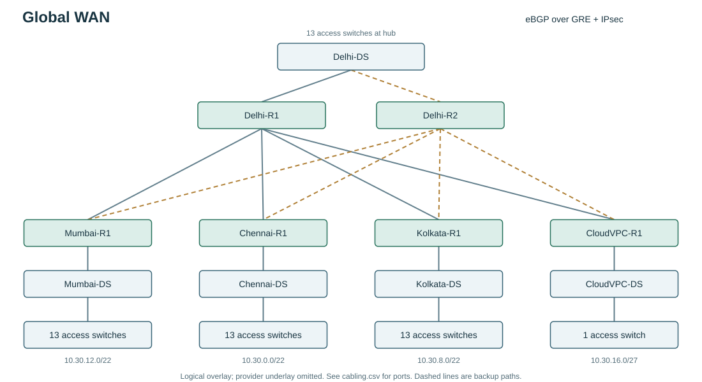

# Global WAN

CIC-307 - NetArchitect generated plan

## Overview

2020 requested endpoints across 5 sites; 10% endpoint growth reserved. Root: 10.30.0.0/16. All planned links use the assignment's 10 Gb/s media rules.

Two HQ edge routers connect 4 remote sites. Routed links keep broadcasts local; 802.1Q trunks are limited to each access switch's VLAN and unused native VLAN 999. Rapid-PVST (RSTP per VLAN) protects local L2 wiring. Independent spoke links to both hubs provide dual-homed path failover. 48-port access switches are counted from planned endpoints, with one VLAN per switch.

Separate city/cloud routing domains use private ASNs and eBGP (RFC 4271). Each site advertises one aligned LAN aggregate (RFC 4632); OSPF Area 0 stays inside each site. GRE over IPsec carries intersite BGP.

Each site's VLAN blocks are placed largest-first inside an aligned site aggregate. Site aggregates and /30 transit blocks are then placed largest-first in the root. Aggregates are reservations, not extra active subnets.

4184 of 65536 root addresses reserved (6.38%). Per-subnet utilization includes endpoint growth and the SVI gateway; root reservation also includes alignment space inside site aggregates.

## Physical media decisions

Endpoint access: Cat6a / 10GBASE-T. 60 m <= 100 m: Cat6a supports the assignment's 10GBASE-T access channel (IEEE 802.3an). The channel includes patch leads. 

In-rack links: Cat6a / 10GBASE-T. 5 m <= 100 m: Cat6a supports the assignment's 10GBASE-T access channel (IEEE 802.3an). The channel includes patch leads. 

Delhi managed-WAN handoff: Cat6a / 10GBASE-T. 50 m <= 100 m: Cat6a supports the assignment's 10GBASE-T access channel (IEEE 802.3an). The channel includes patch leads. The 0.05 km provider path is a managed service, not one Ethernet optical span. The 50 m local handoff uses Cat6a; IPsec protects traffic across the service.

Mumbai managed-WAN handoff: Cat6a / 10GBASE-T. 50 m <= 100 m: Cat6a supports the assignment's 10GBASE-T access channel (IEEE 802.3an). The channel includes patch leads. The 1400 km provider path is a managed service, not one Ethernet optical span. The 50 m local handoff uses Cat6a; IPsec protects traffic across the service.

Chennai managed-WAN handoff: Cat6a / 10GBASE-T. 50 m <= 100 m: Cat6a supports the assignment's 10GBASE-T access channel (IEEE 802.3an). The channel includes patch leads. The 2200 km provider path is a managed service, not one Ethernet optical span. The 50 m local handoff uses Cat6a; IPsec protects traffic across the service.

Kolkata managed-WAN handoff: Cat6a / 10GBASE-T. 50 m <= 100 m: Cat6a supports the assignment's 10GBASE-T access channel (IEEE 802.3an). The channel includes patch leads. The 1500 km provider path is a managed service, not one Ethernet optical span. The 50 m local handoff uses Cat6a; IPsec protects traffic across the service.

CloudVPC managed-WAN handoff: Cat6a / 10GBASE-T. 50 m <= 100 m: Cat6a supports the assignment's 10GBASE-T access channel (IEEE 802.3an). The channel includes patch leads. The 1000 km provider path is a managed service, not one Ethernet optical span. The 50 m local handoff uses Cat6a; IPsec protects traffic across the service.

## Site capacity and summaries

Delhi: 10.30.4.0/22, 13 access switches, 500 current endpoints, 550 planned endpoints. Private AS 65100. PoE groups: none.

Mumbai: 10.30.12.0/22, 13 access switches, 500 current endpoints, 550 planned endpoints. Private AS 65101. PoE groups: none.

Chennai: 10.30.0.0/22, 13 access switches, 500 current endpoints, 550 planned endpoints. Private AS 65102. PoE groups: none.

Kolkata: 10.30.8.0/22, 13 access switches, 500 current endpoints, 550 planned endpoints. Private AS 65103. PoE groups: none.

CloudVPC: 10.30.16.0/27, 1 access switches, 20 current endpoints, 22 planned endpoints. Private AS 65104. PoE groups: none.

## VLAN and access policy

Each VLAN's SVI is its default gateway. The first usable IP is reserved for the gateway; endpoints start at network + 2. An inbound ACL rejects sources outside the VLAN subnet.

Isolated VLANs may ping their gateway and reach CloudVPC service subnets when present; they cannot reach other RFC 1918 destinations. Other destinations are permitted but this lab has no Internet route/NAT. ACLs are stateless, so return traffic from isolated VLANs to internal clients is also denied unless it matches the cloud exception.

Access switches carry only their assigned data VLAN and native VLAN 999 on each trunk. End host ports use PortFast and BPDU Guard. Distribution switches are the local RSTP root.

PoE access groups require a PoE+ switch model and a measured AP power budget. The planner counts Ethernet endpoints, not wireless clients behind each AP.

## WAN routing and encryption

The provider router carries only 198.18.0.0/15 lab underlay addresses. Edges use a static default toward it; these underlay links are excluded from OSPF and BGP.

Point-to-point GRE tunnels are protected by IKEv2/IPsec using AES-256, SHA-256 and DH group 14. A fresh lab PSK is generated for each export and installed consistently in its edge configs. Treat the config directory as containing credentials.

OSPF distributes local VLANs to the edge. Only exact local VLAN prefixes are imported into BGP, then summarized per site. Only remote site aggregates return to OSPF; this avoids redistribution feedback and avoids a permanently advertised Null0 route.

The primary hub path gets BGP local preference 200; secondary gets 100. BGP timers are 3/9 seconds, so silent-failure detection can take about 9 seconds plus convergence. The tunnels use MTU 1400 and TCP MSS 1360; verify with DF pings on the chosen image.

## Offline validation

Offline integer/IP, logical graph and generated-ACL evaluation; no IOS execution.

32/32 checks passed. See offline_checks.json for each packet ACL decision and hub-removal graph check. These results do not establish simulator interoperability, latency, or encryption counters.

## Assumptions and limits

Configurations target a lab IOS/IOS XE feature set. Match interface names and supported commands to the chosen image before pasting.

End hosts use static addresses; DHCP, DNS, Internet access and NAT are outside this lab.

One distribution switch and one router at each remote site remain single points of failure.

CloudVPC is an IOS cloud-gateway emulator, not an actual provisioned cloud VPC.

Both hub routers share one simulated provider. Separate carrier fault domains must be provisioned to protect against provider failure.

WAN IPsec/IKEv2 and BGP require GNS3/CML with a suitable licensed IOS XE image. Packet Tracer support is incomplete.

## Lab inventory

65 devices total. device_inventory.csv lists every device and its active ports. A demo may use one access switch/host per VLAN; the exports retain the complete endpoint-capacity inventory. See cabling.csv for exact port pairs.

Interface names are logical lab defaults: access Gi1/0/1-48 + Te1/1/1, distribution Te1/0/1-48, routers Gi1 onward. Remap names consistently for the installed simulator image. Virtual Gi labels do not represent physical 10 Gb/s transceiver compatibility.

## Active subnet allocation

| Name | Network | Gateway | Broadcast | Usable needed / capacity |
|---|---|---|---|---|
| Delhi:IoT | 10.30.4.0/23 | 10.30.4.1 | 10.30.5.255 | 441 / 510 |
| Delhi:Scanners | 10.30.6.0/25 | 10.30.6.1 | 10.30.6.127 | 111 / 126 |
| Mumbai:IoT | 10.30.12.0/23 | 10.30.12.1 | 10.30.13.255 | 441 / 510 |
| Mumbai:Scanners | 10.30.14.0/25 | 10.30.14.1 | 10.30.14.127 | 111 / 126 |
| Chennai:IoT | 10.30.0.0/23 | 10.30.0.1 | 10.30.1.255 | 441 / 510 |
| Chennai:Scanners | 10.30.2.0/25 | 10.30.2.1 | 10.30.2.127 | 111 / 126 |
| Kolkata:IoT | 10.30.8.0/23 | 10.30.8.1 | 10.30.9.255 | 441 / 510 |
| Kolkata:Scanners | 10.30.10.0/25 | 10.30.10.1 | 10.30.10.127 | 111 / 126 |
| CloudVPC:Services | 10.30.16.0/27 | 10.30.16.1 | 10.30.16.31 | 23 / 30 |
| lan:Delhi-R1 | 10.30.16.72/30 | 10.30.16.73 | 10.30.16.75 | 2 / 2 |
| lan:Delhi-R2 | 10.30.16.76/30 | 10.30.16.77 | 10.30.16.79 | 2 / 2 |
| lan:Mumbai-R1 | 10.30.16.84/30 | 10.30.16.85 | 10.30.16.87 | 2 / 2 |
| lan:Chennai-R1 | 10.30.16.64/30 | 10.30.16.65 | 10.30.16.67 | 2 / 2 |
| lan:Kolkata-R1 | 10.30.16.80/30 | 10.30.16.81 | 10.30.16.83 | 2 / 2 |
| lan:CloudVPC-R1 | 10.30.16.68/30 | 10.30.16.69 | 10.30.16.71 | 2 / 2 |
| backbone:Delhi-R1:Mumbai-R1 | 10.30.16.44/30 | 10.30.16.45 | 10.30.16.47 | 2 / 2 |
| backbone:Delhi-R1:Chennai-R1 | 10.30.16.32/30 | 10.30.16.33 | 10.30.16.35 | 2 / 2 |
| backbone:Delhi-R1:Kolkata-R1 | 10.30.16.40/30 | 10.30.16.41 | 10.30.16.43 | 2 / 2 |
| backbone:Delhi-R1:CloudVPC-R1 | 10.30.16.36/30 | 10.30.16.37 | 10.30.16.39 | 2 / 2 |
| backbone:Delhi-R2:Mumbai-R1 | 10.30.16.60/30 | 10.30.16.61 | 10.30.16.63 | 2 / 2 |
| backbone:Delhi-R2:Chennai-R1 | 10.30.16.48/30 | 10.30.16.49 | 10.30.16.51 | 2 / 2 |
| backbone:Delhi-R2:Kolkata-R1 | 10.30.16.56/30 | 10.30.16.57 | 10.30.16.59 | 2 / 2 |
| backbone:Delhi-R2:CloudVPC-R1 | 10.30.16.52/30 | 10.30.16.53 | 10.30.16.55 | 2 / 2 |

## Subnet calculations

Delhi:IoT: 2^9 - 2 = 510 usable addresses >= 441; /24 would not fit. RFC 4632 CIDR alignment; gateway is the first usable address.

Delhi:Scanners: 2^7 - 2 = 126 usable addresses >= 111; /26 would not fit. RFC 4632 CIDR alignment; gateway is the first usable address.

Mumbai:IoT: 2^9 - 2 = 510 usable addresses >= 441; /24 would not fit. RFC 4632 CIDR alignment; gateway is the first usable address.

Mumbai:Scanners: 2^7 - 2 = 126 usable addresses >= 111; /26 would not fit. RFC 4632 CIDR alignment; gateway is the first usable address.

Chennai:IoT: 2^9 - 2 = 510 usable addresses >= 441; /24 would not fit. RFC 4632 CIDR alignment; gateway is the first usable address.

Chennai:Scanners: 2^7 - 2 = 126 usable addresses >= 111; /26 would not fit. RFC 4632 CIDR alignment; gateway is the first usable address.

Kolkata:IoT: 2^9 - 2 = 510 usable addresses >= 441; /24 would not fit. RFC 4632 CIDR alignment; gateway is the first usable address.

Kolkata:Scanners: 2^7 - 2 = 126 usable addresses >= 111; /26 would not fit. RFC 4632 CIDR alignment; gateway is the first usable address.

CloudVPC:Services: 2^5 - 2 = 30 usable addresses >= 23; /28 would not fit. RFC 4632 CIDR alignment; gateway is the first usable address.

lan:Delhi-R1: 2^2 - 2 = 2 usable addresses >= 2; /31 links are excluded by this lab's conventional network/broadcast model. RFC 4632 CIDR alignment; gateway is the first usable address.

lan:Delhi-R2: 2^2 - 2 = 2 usable addresses >= 2; /31 links are excluded by this lab's conventional network/broadcast model. RFC 4632 CIDR alignment; gateway is the first usable address.

lan:Mumbai-R1: 2^2 - 2 = 2 usable addresses >= 2; /31 links are excluded by this lab's conventional network/broadcast model. RFC 4632 CIDR alignment; gateway is the first usable address.

lan:Chennai-R1: 2^2 - 2 = 2 usable addresses >= 2; /31 links are excluded by this lab's conventional network/broadcast model. RFC 4632 CIDR alignment; gateway is the first usable address.

lan:Kolkata-R1: 2^2 - 2 = 2 usable addresses >= 2; /31 links are excluded by this lab's conventional network/broadcast model. RFC 4632 CIDR alignment; gateway is the first usable address.

lan:CloudVPC-R1: 2^2 - 2 = 2 usable addresses >= 2; /31 links are excluded by this lab's conventional network/broadcast model. RFC 4632 CIDR alignment; gateway is the first usable address.

backbone:Delhi-R1:Mumbai-R1: 2^2 - 2 = 2 usable addresses >= 2; /31 links are excluded by this lab's conventional network/broadcast model. RFC 4632 CIDR alignment; gateway is the first usable address.

backbone:Delhi-R1:Chennai-R1: 2^2 - 2 = 2 usable addresses >= 2; /31 links are excluded by this lab's conventional network/broadcast model. RFC 4632 CIDR alignment; gateway is the first usable address.

backbone:Delhi-R1:Kolkata-R1: 2^2 - 2 = 2 usable addresses >= 2; /31 links are excluded by this lab's conventional network/broadcast model. RFC 4632 CIDR alignment; gateway is the first usable address.

backbone:Delhi-R1:CloudVPC-R1: 2^2 - 2 = 2 usable addresses >= 2; /31 links are excluded by this lab's conventional network/broadcast model. RFC 4632 CIDR alignment; gateway is the first usable address.

backbone:Delhi-R2:Mumbai-R1: 2^2 - 2 = 2 usable addresses >= 2; /31 links are excluded by this lab's conventional network/broadcast model. RFC 4632 CIDR alignment; gateway is the first usable address.

backbone:Delhi-R2:Chennai-R1: 2^2 - 2 = 2 usable addresses >= 2; /31 links are excluded by this lab's conventional network/broadcast model. RFC 4632 CIDR alignment; gateway is the first usable address.

backbone:Delhi-R2:Kolkata-R1: 2^2 - 2 = 2 usable addresses >= 2; /31 links are excluded by this lab's conventional network/broadcast model. RFC 4632 CIDR alignment; gateway is the first usable address.

backbone:Delhi-R2:CloudVPC-R1: 2^2 - 2 = 2 usable addresses >= 2; /31 links are excluded by this lab's conventional network/broadcast model. RFC 4632 CIDR alignment; gateway is the first usable address.

## References

- [RFC 1918 - private IPv4 space](https://www.rfc-editor.org/rfc/rfc1918)
- [RFC 4632 - CIDR and aggregation](https://www.rfc-editor.org/rfc/rfc4632)
- [RFC 2328 - OSPFv2](https://www.rfc-editor.org/rfc/rfc2328)
- [RFC 4271 - BGP-4](https://www.rfc-editor.org/rfc/rfc4271)
- [RFC 4301 - IPsec architecture](https://www.rfc-editor.org/rfc/rfc4301)
- [Cisco 10GBASE SFP+ data sheet - reach and optical power](https://www.cisco.com/c/en/us/products/collateral/interfaces-modules/transceiver-modules/data_sheet_c78-455693.html)
- [Cisco IOS XE IPsec configuration guide](https://www.cisco.com/c/en/us/td/docs/routers/ios/config/17-x/sec-vpn/b-security-vpn/m_sec-cfg-vpn-ipsec-0.html)
